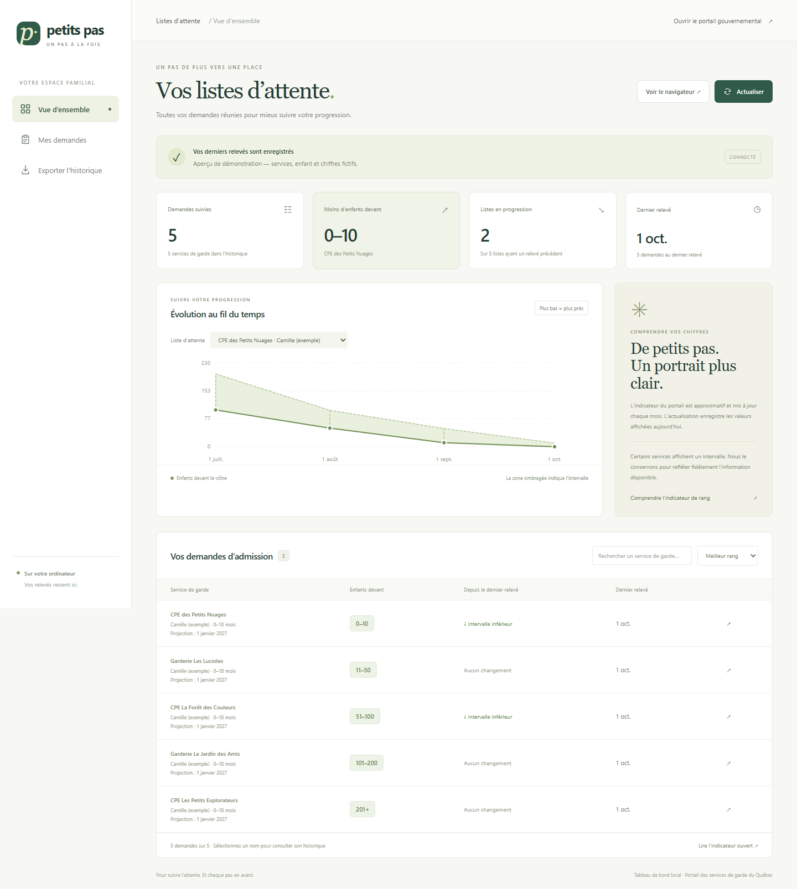

# Petits pas



*Aperçu avec des services de garde, un enfant et des chiffres entièrement fictifs.*

Un tableau de bord **local et en français** pour suivre les listes d’attente du [Portail d’inscription aux services de garde du Québec](https://www.portail-servicesgarde.gouv.qc.ca/parent/s/demandes-admission).

Connectez-vous vous-même au portail. L’application ouvre vos demandes d’admission, consulte leur **indicateur de rang** et conserve des relevés datés sur votre ordinateur. Aucun compte particulier ni aucune liste de garderies n’est intégré au code.

**Version bêta, indépendante du gouvernement du Québec.** Le parcours réel a été vérifié sur un compte sous Windows avec Microsoft Edge. Les autres configurations et comptes peuvent présenter des différences. Les tests automatiques utilisent uniquement des pages et des données fictives.

## Fonctionnalités

- Nombre ou intervalle d’enfants devant le vôtre, pour chaque demande lisible.
- Prise en compte du prénom, de la tranche d’âge et de la date de projection.
- Historique, graphique par demande, recherche, tri et export CSV.
- Parcours des menus de demandes et des pages de résultats.
- Conservation de l’historique lorsqu’une demande ne peut pas être lue. La collecte continue avec les suivantes, même après plusieurs échecs consécutifs.
- Consultation manuelle d’un indicateur ouvert lorsque la lecture automatique échoue.

## Prérequis

1. **Node.js 22 ou plus récent**, avec npm : [télécharger Node.js](https://nodejs.org/). Vérifiez avec `node --version`.
2. **Microsoft Edge installé**, utilisé par défaut. Chrome ou le Chromium de Playwright peuvent aussi être configurés ci-dessous.
3. Un compte donnant accès au portail et des demandes d’admission. Gardez le **portail en français** : le collecteur reconnaît ses libellés français.

Git est également nécessaire pour les tests et les contrôles de partage. Il n’est pas requis pour simplement utiliser une copie téléchargée du code.

L’interface graphique du navigateur doit être disponible pour la connexion et la collecte. L’application ne remplit pas votre mot de passe et ne contourne pas l’authentification à deux facteurs.

## Installation et démarrage

Téléchargez le code ou clonez le dépôt, puis ouvrez un terminal dans son dossier :

```sh
npm ci
npm start
```

Dans Windows PowerShell, utilisez `npm.cmd ci` et `npm.cmd start` si l’exécution de `npm.ps1` est bloquée; utilisez également `npx.cmd` à la place de `npx` dans les commandes ci-dessous. Vous pouvez aussi double-cliquer sur **`start-dashboard.cmd`** : il installe les dépendances manquantes au premier lancement.

Ouvrez **http://127.0.0.1:3210** dans votre navigateur. Gardez le terminal ouvert; `Ctrl+C` arrête l’application.

### Utilisation

1. Cliquez sur **Connexion au portail**.
2. Connectez-vous dans la fenêtre du portail, y compris les vérifications demandées.
3. Ouvrez **Mes demandes d’admission** dans cette fenêtre.
4. Revenez au tableau de bord et cliquez sur **Actualiser**. Laissez le collecteur utiliser la fenêtre du portail jusqu’à la fin de la collecte.
5. Sélectionnez un service de garde pour afficher son historique. **Exporter l’historique** télécharge les relevés en CSV.

Chaque personne qui télécharge le projet utilise son propre compte et ses propres fichiers locaux. La session du portail peut expirer : connectez-vous de nouveau si nécessaire.

## Choisir un autre navigateur

Avec Chrome déjà installé, sous PowerShell :

```powershell
$env:BROWSER_CHANNEL = 'chrome'
npm.cmd start
```

Sous macOS ou Linux :

```sh
BROWSER_CHANNEL=chrome npm start
```

Pour utiliser le Chromium fourni par Playwright, installez-le une fois :

```sh
npx playwright install chromium
```

Puis utilisez `BROWSER_CHANNEL=chromium`, de la même manière que pour Chrome. Sous Linux, des dépendances système peuvent aussi être nécessaires : consultez la [documentation officielle de Playwright](https://playwright.dev/docs/browsers). Le lanceur `.cmd` est réservé à Windows; les commandes npm servent sur les autres systèmes.

## Comprendre les résultats

Le collecteur lit la déclaration mise en évidence dans le graphique SVG, sans confondre sa valeur avec les autres graduations. Les intervalles tels que `11–50` ou `201+` restent des intervalles : l’application n’invente pas un nombre exact et n’additionne pas les listes, car les mêmes enfants peuvent figurer sur plusieurs listes.

La tranche d’âge et la date de projection sont conservées. Si elles changent, la comparaison indique **Projection modifiée** au lieu de compter un progrès.

Selon [l’explication du gouvernement du Québec](https://www.quebec.ca/famille-et-soutien-aux-personnes/enfance/garderies-et-services-de-garde/portail-inscription/parents/indicateur-rang), l’indicateur est approximatif et mis à jour mensuellement. Les services en milieu familial et les garderies non subventionnées peuvent ne pas afficher cet indicateur. Une actualisation du tableau de bord enregistre ce que le portail montre; elle ne provoque pas son recalcul et ne permet pas de prédire une date d’admission.

### Indicateur absent ou illisible

Une demande illisible apparaît dans les avertissements; les autres demandes continuent d’être traitées. Les anciennes valeurs restent visibles avec leur date et la mention **Non actualisée à ce relevé**. Une collecte sans aucune valeur lisible ne remplace pas l’historique.

Pour conserver un relevé manuellement, ouvrez son **Indicateur de rang** dans le navigateur connecté, puis cliquez sur **Lire l’indicateur ouvert**. Vérifiez le service de garde, l’enfant et la valeur avant d’enregistrer.

## Données locales et partage du code

| Emplacement | Contenu |
| --- | --- |
| `.local/history.json` | Demandes, noms d’enfants, identifiants du portail et historique. Sauvegardez ce fichier pour conserver vos relevés. |
| `.local/browser/` | Profil de navigateur séparé, incluant les données de session du portail. |
| `.local/npm-cache/` | Cache d’installation utilisé par le lanceur Windows. |

Le serveur écoute uniquement sur `127.0.0.1`. Le code n’envoie pas les relevés à un service d’hébergement ou d’analyse. Le navigateur communique directement avec le portail et le service d’authentification gouvernemental.

**Ne publiez pas `.local/`, vos exports CSV, vos fichiers `.env`, vos traces de navigation ou des captures contenant des données réelles.** Le `.gitignore` les exclut par défaut. Il ne protège pas un fichier ajouté de force avec `git add -f`, ni une archive assemblée en copiant tout le dossier.

Avant de partager le code depuis un dépôt Git :

```sh
npm run check:share
git status --short
git diff --cached
```

Le contrôle examine les fichiers suivis et les fichiers non ignorés, vérifie les exclusions de données locales et recherche certains marqueurs de secrets. Si un historique local existe, il recherche aussi ses noms complets et identifiants dans les fichiers à partager, sans afficher leurs valeurs. Il ne remplace pas la relecture des changements ou des images. Il ne vérifie pas les anciens commits.

## Configuration

| Variable d’environnement | Valeur par défaut | Rôle |
| --- | --- | --- |
| `PORT` | `3210` | Port du tableau de bord. |
| `BROWSER_CHANNEL` | `msedge` | Navigateur Playwright : `msedge`, `chrome` ou `chromium`. |
| `DATA_DIR` | `.local` dans le projet | Dossier du profil et de l’historique. |

Définissez ces variables dans le terminal avant `npm start`. Les fichiers `.env` ne sont pas chargés automatiquement. Conservez vos données personnalisées hors du dépôt ou dans `.local/`, et utilisez une seule instance par dossier de données.

## Vérifications et contributions

```sh
npm ci
npm run check
npm test
npm run test:browser
npm run check:share
```

Le test avec navigateur utilise le navigateur configuré; Edge est choisi par défaut. Sur une machine qui utilise Chromium, installez-le comme indiqué plus haut puis définissez `BROWSER_CHANNEL=chromium`.

Les tests du collecteur interceptent toutes les requêtes : aucun accès au portail réel ni identifiant gouvernemental n’est nécessaire. Ils couvrent les menus, les commandes textuelles, les listes paginées, plusieurs enfants et la poursuite après des demandes illisibles. GitHub Actions est configuré pour lancer les vérifications de code et de partage sur Windows et Linux, ainsi que les tests avec Chromium sous Linux.

Consultez [CONTRIBUTING.md](CONTRIBUTING.md) pour proposer une modification ou signaler un problème. Le portail peut changer de structure; les sélecteurs et l’extraction devront alors être adaptés. Le parcours reste limité au portail québécois en français, à 50 pages de demandes par collecte et à une utilisation locale avec connexion manuelle.

## Licence

[MIT](LICENSE). Les dépendances conservent leurs propres licences.
